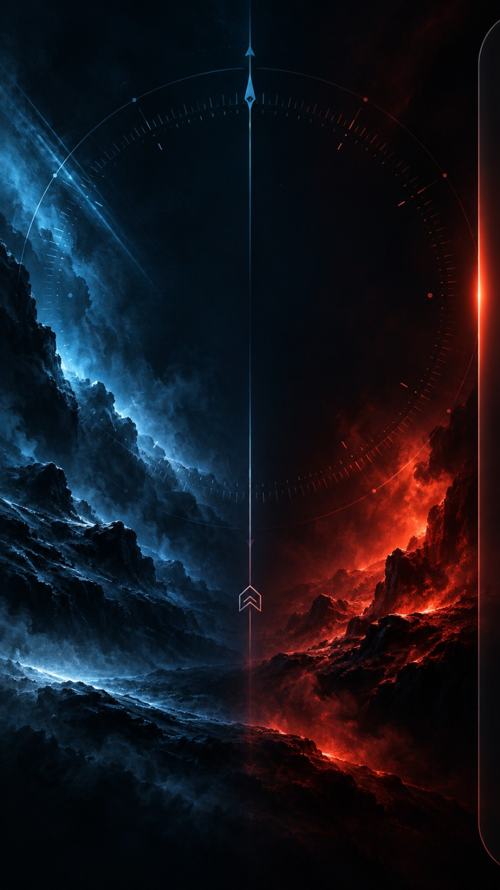
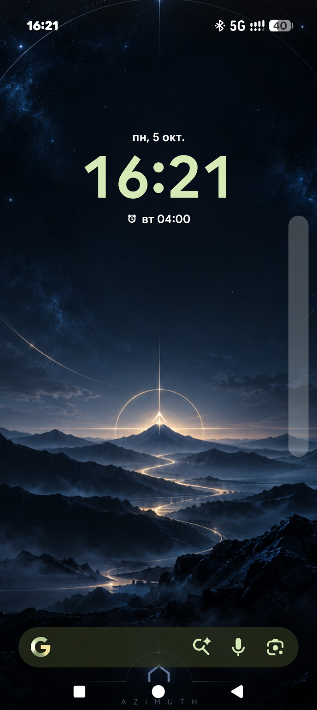
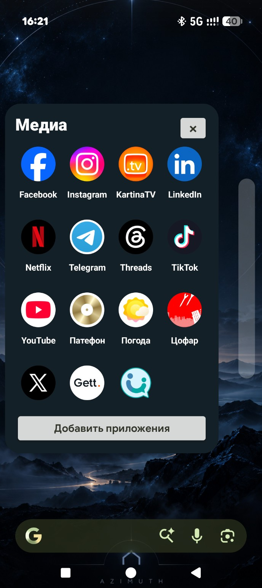
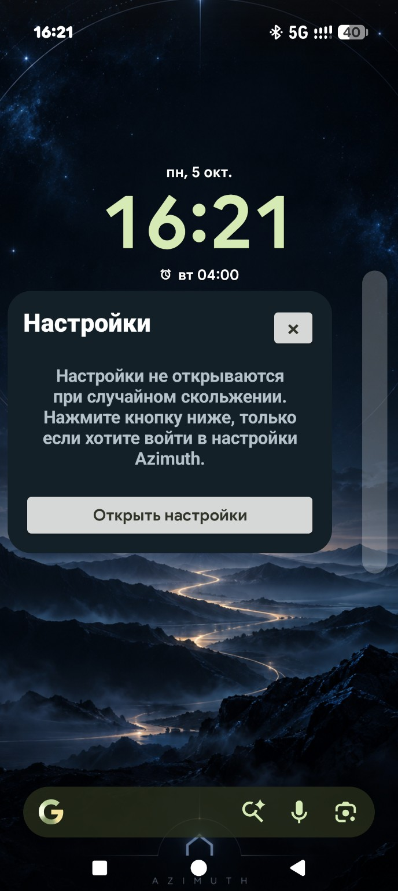
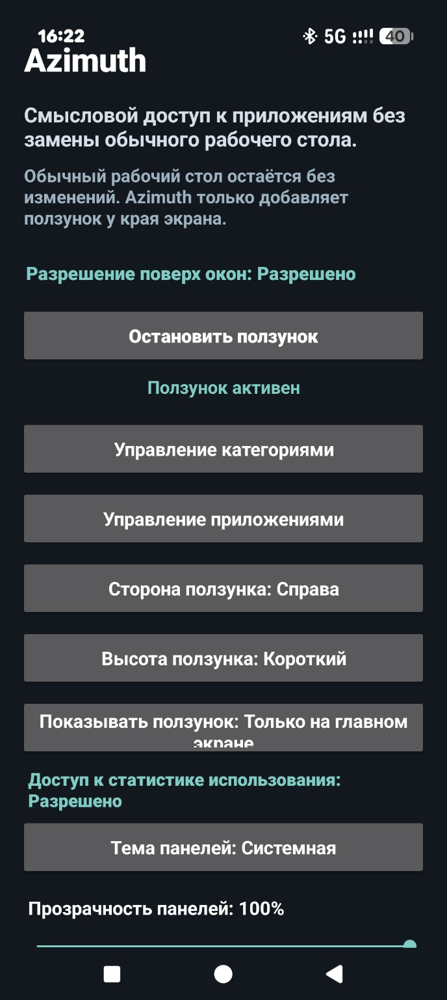

# Azimuth

**Fast Android app access from a configurable edge slider — without replacing your Home screen.**

[Русская версия](README_RU.md)

  
  
  

## About

Azimuth is a lightweight Android utility that adds a slim, configurable edge slider for quick access to your apps.

It does **not** replace the normal Android Home screen. Your existing launcher stays in place; Azimuth adds fast category-based access on top of it.

Current release: **v0.4.2**

Package ID: `com.azimuth171.home`

## Screenshots

  
  

  
  

*These screenshots show the Russian interface. Azimuth also supports English and Hebrew.*

## Features

- Favorites and custom app categories
- Fast app launching from an edge panel
- Reorder apps inside a category
- Move apps between categories
- Configurable left/right edge placement
- Adjustable slider position
- Permanent Settings entry at the end of the category list
- Optional **Home screen only** mode
- Three optional Azimuth wallpapers
- Free to download and use

## Download

Go to **Releases** and download the latest version.

Recommended package:
- `Azimuth-v0.4.2-Android.zip` — APK, wallpapers, installation guide and SHA-256 checksums

You may also download the APK directly from the release assets when available.

## Installation

1. Download the latest release.
2. Extract the ZIP file if you downloaded the full package.
3. Open `Azimuth-v0.4.2.apk`.
4. If Android blocks installation, allow installation from the browser or file manager you used to open the APK.
5. Install and open Azimuth.
6. Grant **Display over other apps** permission.
7. Configure categories and slider position.
8. If you enable **Show slider: Home screen only**, also grant **Usage Access**.

Detailed instructions for Google Pixel, Samsung Galaxy and other Android devices are included in the downloadable package.

## Permissions

### Display over other apps

Required for the edge slider to appear.

Typical path on Google Pixel / stock Android:

`Settings → Apps → Special app access → Display over other apps → Azimuth → Allow`

Typical path on Samsung Galaxy / One UI:

`Settings → Apps → Special access → Appear on top → Azimuth → Allow`

### Usage Access

Required **only** when using:

**Show slider: Home screen only**

Typical path:

`Settings → Apps → Special app access → Usage access → Azimuth → Allow`

Names may vary slightly between Android versions and manufacturers.

## App organization

Long-press an app icon inside a category panel to:
- reorder it within the current category;
- move it to another category.

## Wallpapers

The included wallpapers are optional and are not required for Azimuth to work.

- **Azimuth Night** — dark mountain / night theme
- **Azimuth Forest** — dark forest and water theme
- **Azimuth Blue Red** — blue / red contrast theme

## Tested on

- Google Pixel 10 Pro
- Samsung Galaxy Flip 8

## Languages

Azimuth currently supports:
- English
- Russian
- Hebrew

## Distribution

Azimuth is **free to download and use**.

The source code is currently **not published**.

## Feedback

If you find a bug or have an idea for improvement, please open an **Issue** in this repository.

---

**Azimuth v0.4.2**  
Android release
